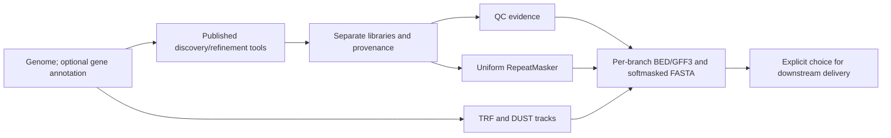

# TEflow

**1.0.0 · Single-species TE annotation with traceable outputs**

TEflow runs published discovery and refinement tools, builds separate TE libraries, and annotates each library with a uniform RepeatMasker route. It exports libraries, structural candidates, fragment GFF3/BED, softmasked genomes, QC evidence and provenance for genome annotation and TE research. Expression data and pCRE are optional downstream uses.

[Install](docs/INSTALL.md) · [Commands](docs/COMMANDS.md) · [Results guide](docs/RESULTS_GUIDE.md) · [1.0 changes](docs/RELEASE_v1.0.md) · [Validation](docs/TEST_STATUS_v1.0.md) · [服务器交接](docs/SERVER_v1.0_zh.md) · [Documentation index](docs/INDEX.md)

## Start with one genome

Production requires Linux. Install the wrapper, enabled upstream tools and databases using [INSTALL](docs/INSTALL.md). These tools and data are not bundled. In a configured engine, start with EDTA alone:

```bash
teflow init --root /data/te_project --genome /data/inputs/genome.fa \
  --sample-id my_plant --run-id my_plant_01 --profile edta \
  --threads 32 --mem-mb 131072
# Configure and lock the actual installed databases as described in INSTALL.
teflow plan --config /data/te_project/my_plant_01.local.json
teflow check --config /data/te_project/my_plant_01.local.json
teflow run --config /data/te_project/my_plant_01.local.json --dry-run
teflow run --config /data/te_project/my_plant_01.local.json
teflow report --config /data/te_project/my_plant_01.local.json --output /data/reviews/my_plant_01
teflow select --config /data/te_project/my_plant_01.local.json \
  --branch edta --policy te_primary --output /data/deliverables/my_plant_01
```

`python -m teflow` is equivalent to `teflow`. Without `--profile edta`, `init` defaults to E + ET. Gene annotation is optional; promoter analysis is off by default. No command automatically chooses the biologically best library. The selected delivery defaults to relative links; use `--mode copy` for portability.

`plan` is read only. `check` audits inputs and probes installation. `run --dry-run` freezes the run and checks its DAG without genome discovery. `run-preview`, `status`, `logs`, `runtime-summary` and `report` explain progress and evidence. `cancel` requests scoped, cooperative cancellation; `run --resume` requires the unchanged original version/configuration. Preserve old frozen runs when upgrading.

## Separate routes and outputs

| Branch | Route | Intended role |
|---|---|---|
| E | EDTA | Baseline TE discovery and annotation |
| ET | EDTA → TEtrimmer | Refinement comparison; may omit many E families and retain original-input fallbacks |
| H | HELIANO with EDTA-assisted nested cleanup | Optional Helitron supplement |
| EH | E + cleaned H | Experimental combined-library comparison |
| I | HiTE | Optional comparison with bundled homology resources/models |
| R | User-supplied reference library | Fixed-library remapping/control |



Combining libraries folds full-length exact or reverse-complement aliases within the same class. It does not infer approximate TE families or automatically choose the best library. Fragment alignments are not complete insertions. Classified-TE, tandem-repeat and DUST masks are combined for the primary softmasked FASTA; Unknown intervals remain separate unless an additional inclusive mask was explicitly requested. See the [results guide](docs/RESULTS_GUIDE.md).

## Execution and limits

Execution is serial by default. Opt-in branch concurrency uses one Snakemake DAG with CPU/memory reservations, I/O slots, private temporary directories and sampled memory observations. CPU leases are disjoint within one pool. Independent work roots do **not** coordinate CPU ownership; `plan`/`run-preview` show inherited affinity, and external taskset/Slurm allocation can separate projects. Memory admission is **not a hard memory limit**. Multi-species queues, automatic controller recovery and production cgroups remain outside 1.0.

The 0.6 Arabidopsis run completed all five discovery/comparison branches with observed RepeatMasker overlap. Its E and EH classified-TE coverage was 15,016,254 and 16,409,707 bp; the net difference is about 1.39 Mb. These are aligned coverage, not confirmed novel TE truth. The 0.7 supervisor passed bounded target-server acceptance on 2026-10-22. Current 1.0 changes have their own [validation record](docs/TEST_STATUS_v1.0.md); neither fixture tests nor one plant genome establish cross-species accuracy.

## Install and develop

The distribution is **te-annotation-workflow**, the CLI/import is **teflow**, and the project is **TEflow**. Python >=3.10 is required; the tested engine uses Python 3.11 and Snakemake 9.27.0. Windows supports portable audits/configuration/tests. Use source or a local wheel; no PyPI publication is assumed.

```bash
python -m pip install '.[engine]'
python -m teflow --version
python -m teflow capabilities
# Development, with the upstream-free synthetic scheduler fixtures:
python -m pip install '.[dev]'
python -m unittest discover -s tests -v
python tests/integration_cli.py
python tests/integration_parallel.py --pool-threads 4
python -m build
```

Wheels include runtime recipes. Source bootstrap scripts provision external environments separately. Source/upload checksum gates are not required; downloaded tools/databases retain integrity checks and scientific provenance identities remain internal. Old repair documents are historical records, not fresh-install checklists.

[Contributing](CONTRIBUTING.md), [extension contracts](docs/EXTENDING.md) and [release preparation](docs/GITHUB_RELEASE.md) describe maintenance. Wrapper code is MIT licensed. Upstream tools, models and databases retain their own licenses and should be cited as described in [THIRD_PARTY](docs/THIRD_PARTY.md). Author: Feiyu Chen ([ORCID](https://orcid.org/0009-0008-5269-5023)); citation metadata is in [CITATION.cff](CITATION.cff). Genomes, databases, containers, real run directories and full logs are excluded from the source distribution.
