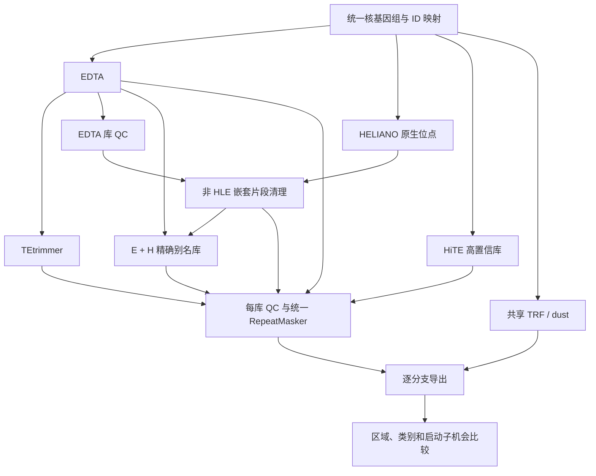

# TE annotation workflow 0.2：执行与比较协议

日期：2026-10-13。0.2 是工程试用版。当前比较范围是拟南芥 TAIR10；模拟接口通过不等于真实 TE 发现通过。本文件描述实际实现，替代新运行所用的 v0.1 协议；旧运行保留原协议和目录。

## 1. 分支与依赖

| 配置名 | 上游或组装来源 | 公共回贴 | 解释 |
|---|---|---|---|
| `edta` | EDTA 2.3.0 | `rm_edta` | 原始基线 |
| `edta_tetrimmer` | EDTA → TEtrimmer 1.7.2 | `rm_refined` | 精修、低拷贝和回退有不同来源 |
| `heliano` | HELIANO 1.3.1 + EDTA 非 HLE 清理 | `rm_heliano` | EDTA 辅助的 HLE 专项分支，不能称为独立全 TE 基线 |
| `hite` | HiTE 3.3.3 的 `confident_TE.cons.fa` | `rm_hite` | 使用内置同源资源和训练模型，不能称为无参考发现 |
| `edta_plus_heliano` | E + H 的精确序列别名组装 | `rm_edta_plus_heliano` | 实验组合，不自动成为默认 mask |
| `reference_only` | 用户明确登记的参考共识库 | `rm_reference_only` | 条件分支，不能以 TE 坐标文件替代共识 FASTA |
| `reference_plus_edta` | R + E 精确序列别名组装 | `rm_reference_plus_edta` | 条件分支 |

新建 `arabidopsis-compare` 配置默认启用前五项。后两项仅在每个样本提供 `reference_library` 后手动启用。`baseline` 只启用 E、ET。未启用的分支不会加入 DAG，也不要求安装其软件。修改启用项或科学参数后必须使用新 run ID。



每条分支有独立的 `library → QC / RM → export_branch` 任务；HELIANO 额外依赖 `qc_edta`，组合分支依赖 `qc_heliano`。一个分支失败，其他已完成分支可以单独导出；只有所有启用的分支完成，才写总比较回执。没有“自动选胜者”步骤。

## 2. HELIANO 的版本适配

核查依据是 [1.3.1 源码](https://github.com/Zhenlisme/heliano/tree/v1.3.1)。`RC.representative.bed` 虽然扩展名为 BED，但该版 `OutputSequence` 使用 `start-1:end` 提取序列。适配器将其解释为 1-based closed，转换为 0-based half-open，并用正负链 FASTA 回抽逐条验证。坐标或 ID 不一致即失败。

必须同时存在原生 FASTA、11 列坐标表和终端 `pairlist.tbl`。只有满足完整输出契约的空结果，才记录 `zero_candidates=true`；提前 `exit(0)`、缺文件或错误日志不能被记为零候选成功。

默认参数固定为 `-w 10000 -dm 2500 -dn 0 -is1 1 -is2 1 -sim_tir 100 -flank_sim 0.5 -p 1e-5 -s 32 -pt 1 -tb 0`，不启用 `--nearest`。其中 insertion-site 严格选择是本协议的实验设定；上游代码的 IS1/IS2 默认值是 0，不能写成完全使用上游默认参数。

**建库默认值是 `library_mode=native_representatives`。** 原生预测片段作为序列模型，不冒充每家族唯一的共识。它们的数量也不是已经去重后的家族数。原生 HLE1/HLE2、subfamily、strand、mobility 与位点 ID 另存；RM 广义类统一为 `RC/Helitron`，不能据此区分 HLE1/HLE2 的回贴片段。

显式实验选项 `official_consensus` 调用同包 `heliano_cons`，其自身版本横幅为 1.0.2。源码会向两端扩展各 50 bp，并去掉共识中的 gap/N；因此不保证原生边界，也不能将扩展出的片段直接当作确定的 TE 边界。适配器检查每个输入 subfamily 至少产生一个共识，记录支持关系而非伪造精确比对。上游采用线程池及内部 cd-hit 多线程，调用 worker 数限制为总核预算的平方根下取整。本选项尚需服务器真实数据验收，默认关闭。

清理库只取 EDTA 已分类、非 HLE、非全模糊碱基、没有宿主蛋白命中标记的序列；Unknown 和 EDTA HLE 不进入清理库。若蛋白 QC 未启用，只能说明通过基础 QC，不能声称排除了宿主基因污染。用公共 RepeatMasker 在 H 序列上查找该库，命中区置 N，保持长度和原位置；全无 ACGT 的候选单列排除原因。原序列哈希、屏蔽后哈希、区间、EDTA 来源和多父节点关系全部保留。任何清理增益都同时受 EDTA 影响。

## 3. HiTE 的版本适配

按 [HiTE 3.3.3 官方说明](https://github.com/CSU-KangHu/HiTE/tree/v.3.3.3)，使用 `kanghu/hite:3.3.3` 的本地 Apptainer SIF，独立于现有 Conda 环境。下载后校验 CLI，冻结实际 SIF SHA256；标签不是不可变 digest，跨服务器复现应复用同一个 SIF 和散列。

默认 `plant=1, te_type=all, recover=0, annotate=0, search_struct=1, use_HybridLTR=1, use_NeuralTE=1, min_TE_len=80, chrom_seg_length=1000000, remove_nested=1`。关闭上游内置 benchmark，保留 debug 证据，最终只采用 `confident_TE.cons.fa`。低置信候选留在 raw 目录，不混入公共回贴库。

该版上游可在子命令失败后仍返回 0，且会清理自己的输出目录。因此每次尝试使用全新 `raw` / `raw.attemptNNN`，扫描上游日志，并校验最终库。无高置信库或空库按无法判定成功处理，不能用“可能没有 TE”替代报错。零候选判断与 HELIANO 的终态契约不同。

HiTE 的内部 cd-hit 存在 `-T 0`；Linux 执行器约束进程 CPU affinity，子进程继承。内存参数目前为 Snakemake 调度预算，**不是 cgroup 强制上限**；生产建议由 Slurm/cgroup 分配内存。原生 GFF/BED 若存在会登记为阶段产物，但本版未提供跨 HiTE 结构类型的统一完整插入评价，不能根据公共 RM 输出声称完整插入数。

## 4. 库 QC、分类和组合

基础 QC 输出长度、GC、N/非 ACGT、分类层级、精确/反向互补重复和标记。可选宿主/TE 蛋白用 DIAMOND blastx，Pfam 用标准核遗传密码的六框翻译与 hmmscan。命中及域是审核证据；缺少域不是阴性标签。除 HELIANO 明确的嵌套清理契约外，QC 不自动删除候选。

`qc.host_proteins="derived"` 使用 prepared 阶段已验收的宿主 CDS，拒绝不能以标准核遗传密码完整翻译的 CDS。也可提供外部蛋白 FASTA；蛋白版本必须和基因组对应，文件散列冻结。由 GTF/GFF 的基因类型标记排除已知 TE 编码基因，但不能保证排除未注释 TE 基因或驯化的 TE 衍生基因。外部 CDS 文件的生物学筛选责任须另行记录。

`MITE` 正确归入 TE，而不是 Unknown。类别表同时保留原始标签、标准类和 `mapping_version=0.2`。已知根类后的 `?` 保留不确定性标记；真正未识别的标签报错，避免静默落入生物学 Unknown。`TIR_MITE` 是粗分组，不是重新鉴定超家族。

组合只合并**分类相同且全长序列完全相同或反向互补相同**的别名；保留多来源关系。相同序列的分类冲突保留两条。近似 80-80-80、重叠位点和长短包含均不自动删除，也不重新拼接共识。因此组合库可能冗余；应查看标记和回贴差异，不能声称已完成家族级优化去冗余。

## 5. 公共回贴与评价

所有库使用共享 RepeatMasker 4.2.4 / RMBlast 2.17.0，固定 `-s -nolow -no_is -div 40`，并行进程数为总核预算除以 4 向下取整。TRF 和 dust 每样本只运行一次。`te.mask.bed` 包含已分类 TE；`repeat.mask.bed` 为 TE+TRF+dust；Unknown 单独输出。

记录库条目、命中条目、RM 片段、片段长度总和和区间并集 bp，不把这些不同数量都叫 TE 拷贝数。类别 × selected_genome / promoter_all / promoter_near / promoter_far 输出区间覆盖；分支对输出交并、Jaccard、左右独有区间。不同类别可能有重叠，类别并集不能直接相加代替全体 TE 并集。

`sample.reference_te` 是与原始染色体 ID 对齐的 GFF3/GTF；默认只读 `transposable_element` 和 `repeat_region`，分类属性默认 `Classification`（兼容小写）。未知参考类单列为 unmapped，未提供分类单列为 unclassified。参考被当作不保证完整、也不保证独立的比较资料。输出 `reference_coverage` 和 `prediction_inside_reference`，不直接叫 recall/precision，参考外新增预测不直接叫假阳性。**本版没有实现共识家族的独立敏感度、插入边界准确率或自动家族恢复评价。**

可以提供 `sample.promoters_bed`：原始 seqid、BED6、唯一 gene ID、strand，0-based half-open。无此文件时，按 gene 边界推定 TSS、默认上游 1500 bp，并在邻居基因体处截断；近端 500 bp，零长度窗口保留。这是 provisional 窗口，不冒充 pCRE 的冻结坐标。

每个启动子输出 M0、M1_TE、M2_TE_unknown、M3_TE_unknown_tandem_dust，以及 primary_repeat_TE_tandem_dust；默认宽度 4…20。机会数是每个连续 ACGT 片段的 `max(0,L-w+1)` 之和，原有 N 与新 mask 都会打断窗口。它是**完整包含于区间的起始位置数**，不是双链计数或以中心归区的填充扫描机会数。pCRE 若使用边界填充、中心归区或全基因组背景，必须按自己的冻结窗口重算，不能直接复用不同定义的分母。空窗口机会数为 0，比例留空。

## 6. 冻结、失败与复用

schema 1 仍可读取；新工作明确用 schema 2。`freeze` 登记配置、FASTA/注释/可选参考/蛋白、数据库、工具文件/Conda 元数据、HELIANO 包文件、HiTE SIF、封装源码与引擎版本。每阶段依赖内容和完成产物均有 SHA256。Snakemake 直接入口也先核查冻结状态。

`.dag/*.done` 只是可重建的调度指针，权威回执是 `prepared/manifest.json` 和各阶段 `complete.json`。Snakemake 因时间戳决定重跑时，只能删除指针；CLI 会验证并复用未改变的科学产物。更改输入、已完成产物、软件或参数后拒绝普通 resume。

doctor 每次写新的 attempts 子目录，失败尝试不会占用权威成功回执。启动器每次实际重做依赖检查；第一次成功的 canonical doctor 保持稳定。最新检查结论查 attempts/，不要只看 canonical 的时间。SIGINT/SIGTERM/SIGHUP 或超时会清理该命令的进程组；返回 0 但仍遗留活动子进程也判为异常。SIGKILL 不能捕获，重试会核查 owner 和 running command 记录。`unlock-stage` 只移除 Linux 同主机上证明失效且无活跃进程组的锁，不按旧 PID 自动杀进程。

跨版本导入仅开放完整且验证通过的 `edta`、`rm_edta`；核对旧配置/输入、prepared 序列/CDS、线程、参数、相关工具/数据库和输出散列。导入到新 run，旧结果保留。拒绝失败 TEtrimmer 导入；新 ET 必须干净执行。不能把迁移当作通用“忽略指纹”开关。

## 7. 实际目录契约

```text
work/<run_id>/
  run_manifest.json
  doctor/doctor.json  doctor/attempts/<attempt>/
  <sample>/
    prepared/manifest.json genome.fa seqids.tsv ...
    .dag/*.done
    tracks/ edta/ tetrimmer/ heliano/ hite/
    edta_plus_heliano/ reference_only/ reference_plus_edta/
    qc_<branch>/ rm_<branch-stage>/ export_<branch>/ export/
results/<run_id>/<sample>/
  <branch>/
    library.fa family_provenance.tsv parents.tsv 或 library.parents.tsv
    library_qc/ classification_inventory.tsv
    te_fragments.gff3 mask_sources.tsv *.bed genome.softmasked.fa
    native/ 或 native_sites.tsv（工具可提供且已有适配时）
    regional_evaluation.tsv promoters.tsv promoter_opportunities.tsv
    evaluation.json qc.json manifest.json
  differences/ branch_discordance.tsv comparison.json manifest.json index.html
```

工作目录采用平铺 stage 以兼容已有审计工具；结果按分支归档。日志和原生中间件在 work 中保留。stage `complete` 只代表满足计算契约，最终 `computed_awaiting_review` 仍等待生物学解释。软件发布时间和真实服务器运行完成时间应分别登记。
