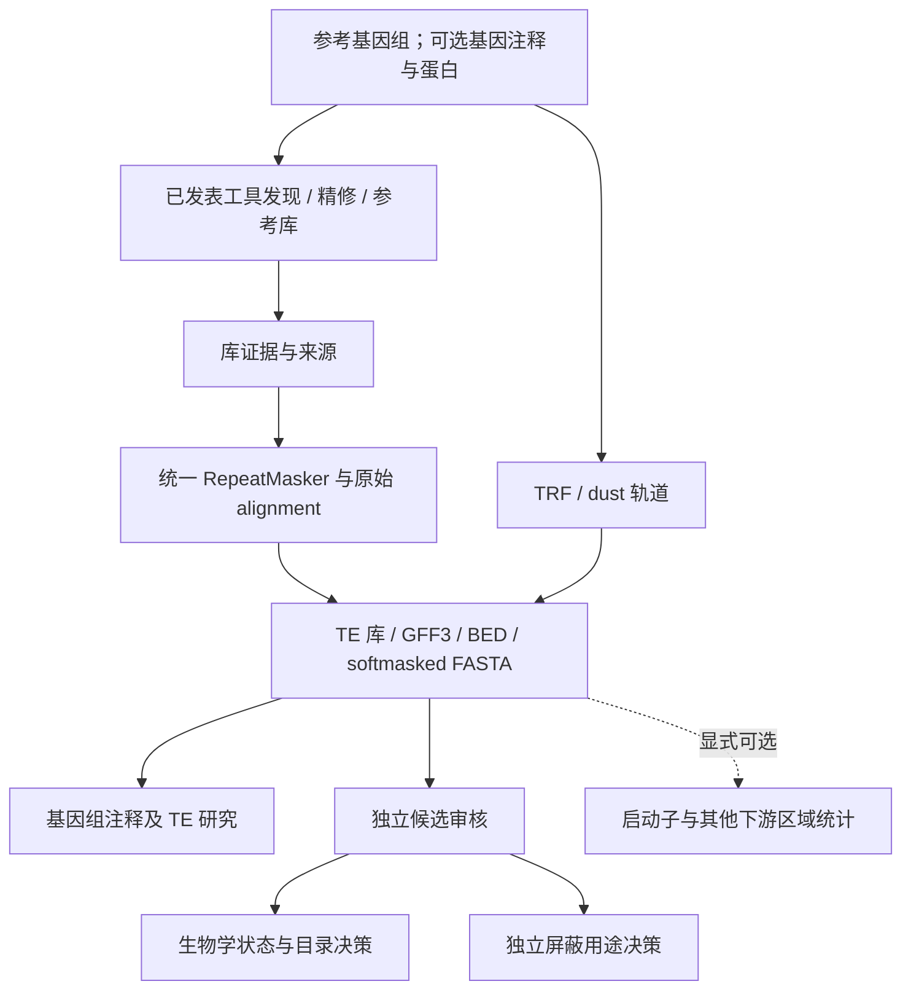

# TE annotation workflow

Version **0.3.1** · 通用 TE 注释与证据审核工作流 · 2026-10-16

本项目组织 EDTA、TEtrimmer、RepeatMasker、HELIANO、HiTE 等已发表工具，提供可追溯的 TE 库、结构位点、同源注释、BED/GFF3、softmasked FASTA、比较报告和审核记录，服务于基因组注释、TE 目录整理及其他下游研究。封装代码不提出新的 TE 发现算法。

**pCRE 是可选下游应用之一。** 核心流程不依赖表达矩阵、聚类标签、motif 长度或预测结果。新配置默认关闭启动子/扫描机会数分析；已有冻结配置保留其原有语义。新建 `init-server` 默认使用 `baseline`（E、ET）；五分支拟南芥比较需显式指定 `--profile arabidopsis-compare`。

拟南芥 v022 的五分支计算已完成并收到了真实结果。0.3.0 将后续候选审核独立于该运行：继续使用旧配置和完成产物，创建新的审核目录，不对旧结果就地升级。本版不是已经验证准确率优于其他工具的“最佳 TE 注释器”。

## 入口

- [0.3.1 局部边界审核](BOUNDARY_REVIEW_v0.3.1.md)：明确选择位点后比较内部、末端、侧翼；不自动认定完整拷贝。
- [0.3.1 服务器复现命令](SERVER_BOUNDARY_v0.3.1_zh.md)：本轮小范围真实计算已在本地完成；仅在需要服务器独立复现时执行。
- [0.3 协议与架构边界](PROTOCOL_v0.3.md)
- [0.3.0 蛋白审核命令](SERVER_REVIEW_v0.3_zh.md)：历史步骤，本轮已收到并复核其结果。
- [当前测试与真实数据验证状态](TEST_STATUS_v0.3.1.md)
- [第三方代码复核入口](ARCHITECTURE_REVIEW.md)
- [通用新项目配置示例](../examples/general_genome.json)：配置文件可使用任意合法样本 ID/基因组路径，预设物种名不构成算法限制。

首次安装沿用 [分环境部署说明](SERVER_HANDOFF_v0.2_zh.md)，并按本版协议选择分支及新运行目录。历史修复文档只适用于其指定运行，不是新项目安装步骤。

## 核心与可选分析



分支包括 EDTA、EDTA→TEtrimmer、EDTA 辅助清理的 HELIANO、HiTE、E+H，以及按需启用的参考库分支。HELIANO 分支有 EDTA 依赖，不能称为独立全 TE 基线。组合库只折叠同分类的全长精确/反向互补别名；不自动拼接、近似合并或删去包含关系。

0.3.1 增加独立的 `boundary-prepare / boundary-plan / boundary-run / boundary-pack`。输入为参考基因组、人工选择的位点表和可选 GTF/GFF3；调用 BLASTn、可选 MAFFT/DUST，保留逐列核验、工具指纹及双方向分区覆盖。此功能不改变 TE 发现 DAG、旧注释或目录/屏蔽决策；可用于任意物种的明确选择位点。已有 0.3.0 审核仍使用原版本完成其冻结协议，新增边界审核创建新目录。

0.3.0 已有功能：

- 新 RepeatMasker 阶段登记非空 `.align` 散列；有命中却缺少请求的 alignment 会停止。旧导入可核验并复制原执行目录的辅助文件；不自动重算。
- `review-prepare` 核验原始比对的逐列序列/坐标，将最终家族和原始家族分开。候选原生位点、基因/CDS/转录本重叠及带侧翼序列进入独立目录。
- `review-plan/run` 仅扩展所选候选的 DIAMOND 蛋白证据，记录两侧坐标、阅读框及 BTOP。保留旧结果；无蛋白命中不是非基因证明。
- `review-export` 分别输出人工决定保留的生物学目录库和屏蔽用途候选库；默认全部 pending。它不改写旧基因组 mask，也不自动运行回贴。
- `review-pack` 生成紧凑反馈包，排除原基因组、原注释、蛋白数据库和 DIAMOND 索引。

CDS 重叠、宿主蛋白相似性及多基因包围均是审核证据。潜在基因捕获候选可以保留在 TE 生物学目录中，同时暂不用于屏蔽。边界未决的候选不因一次无命中而自动通过。

## 开发验证

```bash
python -m pip install .
python -m unittest discover -s tests -v
# Linux：真实调度器，模拟上游工具
python -m pip install snakemake==9.27.0
python tests/integration_v02.py
# 已有 DIAMOND 2.1.11 时可做单线程短合成序列检验
python tests/integration_candidate_qc_real.py --diamond /path/to/diamond
```

生产发现依赖 Linux/服务器环境。源码、`workflow/`、`scripts/` 一起部署；仅 wheel 不包含完整工作流。0.3.0 局部审核复用已有 engine/qc 环境，无需重装全部工具或重新下载数据库。

封装代码采用 MIT 许可；上游代码、模型和数据库各自遵循其许可，见 [第三方来源](THIRD_PARTY.md)。包不含真实基因组、数据库、大日志或镜像，尚未发布到远程 GitHub。
